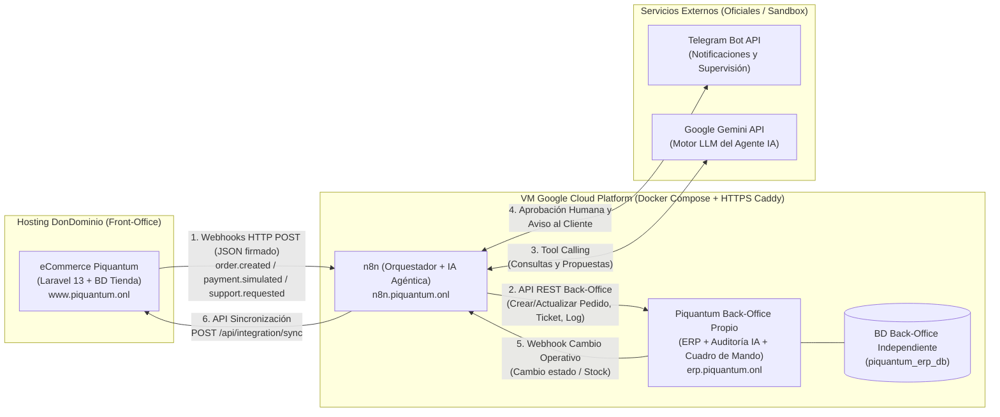

# Plan Maestro — Tarea 2: Integración, Automatización e IA Agéntica (Piquantum)

> **Asignatura:** Soluciones Informáticas para la Empresa (UCAM) — Tarea 2  
> **Grupo:** Álvaro Acedo Sánchez · Abel Martínez Candela · Antonio Martínez Pallarés  
> **Punto de partida:** Canal digital **Piquantum** (`www.piquantum.onl`, Laravel 13 + MariaDB en DonDominio)  
> **Decisión de Back-Office:** **Aplicación propia ligera de Back-Office (ERP/CRM + Cuadro de Mando + Auditoría IA)** desplegada como sistema independiente con su propia base de datos en la **VM de Google Cloud (GCP)** junto a **n8n**.

---

## 1. Arquitectura General y Despliegue en la Nube

Cumpliendo estrictamente con las Aclaraciones 1 y 2 del profesor (*"el back-office es un sistema distinto del eCommerce, con su propio almacenamiento y acceso independiente"* y *"ambos deben estar desplegados fuera del entorno local"*):

1. **Front-Office (Canal Digital - Tarea 1):**
   - Sigue alojado en **DonDominio** (`https://www.piquantum.onl`) con su propia base de datos MariaDB (`piquantum_db`).
2. **Plataforma de Automatización (`n8n`):**
   - Alojada en contenedor Docker en la **VM de Google Cloud (GCP)**, accesible públicamente mediante HTTPS en `https://n8n.piquantum.onl`.
3. **Sistema de Back-Office Propio (`Piquantum ERP / Back-Office`):**
   - Aplicación web independiente alojada en la **VM de Google Cloud (GCP)** en `https://erp.piquantum.onl`, con **su propia base de datos aislada (`piquantum_erp_db`)** y su propia API REST.
   - ¿Por qué un Back-Office propio sencillo en vez de Odoo?
     - Permite diseñar una **API REST JSON limpia** a medida para los flujos de n8n y las herramientas (*Tools*) del Agente de IA.
     - Integra de forma nativa en una sola interfaz los **5 bloques que exige la rúbrica**:
       1. Gestión de Pedidos, Clientes y Stock sincronizados.
       2. Gestión de Incidencias Postventa.
       3. Bandeja de **Supervisión Humana y Auditoría del Agente de IA**.
       4. Visor de **Logs y Trazabilidad de Integración** (ejecuciones correctas y fallidas).
       5. **Cuadro de Mando Operativo** en tiempo real (métricas y gráficos).
     - Facilita que los **3 miembros del grupo aporten commits reales de código en GitHub** (requisito obligatorio del Apartado 11).



---

## 2. Módulos y Base de Datos del Back-Office Propio (`erp.piquantum.onl`)

El sistema de Back-Office tiene su propio login independiente y cuenta con **9 tablas propias** en su base de datos (`piquantum_erp_db`; en la implementación, SQLite en `storage/database/piquantum_erp.sqlite`):

| Tabla en `piquantum_erp_db` | Propósito en la Tarea 2 |
|---|---|
| `erp_customers` | Ficha consolidada de clientes sincronizados desde el canal digital (`external_id`, nombre, email, total gastado, nº de pedidos, nivel de riesgo/VIP). |
| `erp_orders` y `erp_order_items` | Pedidos registrados en el Back-Office (`order_ref` ej. `PQ-20261108-XXXXXX`, cliente, líneas con SKU y formato 50/100/200ml, importe total, estado de pago, estado logístico y fecha). |
| `erp_inventory` | Control de stock de almacén por SKU de salsa picante y tamaño, umbral de stock mínimo y prioridad de reposición. |
| `erp_tickets` | Incidencias postventa, consultas o devoluciones asociadas a un cliente y a un `order_ref`, con estado (`abierta`, `en_revision_ia`, `aprobada`, `resuelta`, `rechazada`), prioridad y timestamps para calcular el tiempo medio de resolución. |
| `erp_integration_logs` | **Evidencia de Trazabilidad (Apartado 3.e y 3.f):** registra cada ejecución del flujo (`execution_id`, escenario, evento origen, dirección, payload recibido, resultado `SUCCESS` o `ERROR`, código de error y mensaje de validación). |
| `erp_ai_audits` | **Evidencia de IA Agéntica y Supervisión Humana (Apartado 6):** guarda la salida estructurada de 7 campos del Agente IA, las herramientas invocadas, el estado (`pendiente_de_revision`, `aprobado`, `rechazado`), el usuario supervisor, la fecha de decisión y si n8n confirmó la notificación por Telegram. |
| `erp_processed_events` | **Idempotencia:** `event_id` de los eventos de la tienda ya procesados; un evento repetido se responde como `duplicate`. |
| `erp_outbox_webhooks` | **Bandeja de salida hacia n8n:** avisos de cambios del Back-Office (Escenario 2) y de aprobaciones (Escenario 3), con su estado de entrega y los reintentos. |

---

## 3. Diseño de los 3 Escenarios Obligatorios (Apartados 4 y 5)

Cada workflow en **n8n** cumplirá los elementos obligatorios del Apartado 4:
`Disparador Webhook` → `Validación de Payload y Firma HMAC` → `Rama Correcta (Transformación + Llamada API Back-Office + Log OK)` / `Rama de Error o Datos Incompletos (Log de Fallo + Alerta)` → `Notificación / Seguimiento`.

### Escenario 1: Pedido generado e integrado (`order.created` / `payment.simulated`)
1. **Origen (Canal Digital):** Un cliente de prueba (`laura@example.com`) realiza un pedido en Piquantum y completa el pago en el TPV Redsys de pruebas (entorno *sandbox* oficial; en la demo no se usa ningún otro método de pago).
2. **Envío:** Piquantum dispara automáticamente un Webhook HTTP POST a n8n con el contrato JSON del pedido.
3. **Procesamiento en n8n:**
   - **Validación:** Comprueba firma `X-Piquantum-Signature` y campos obligatorios (`order_ref`, `customer.email`, `items` no vacío, `total > 0`, `status`).
   - **Rama de Error (Demostrable):** Si se envía un payload de prueba sin `order_ref` o con importe negativo, n8n desvía la ejecución por la rama de error y registra el fallo en `erp_integration_logs` (`ERR_INVALID_PAYLOAD`).
   - **Rama Correcta e Idempotencia:** Normaliza los estados y llama a `POST /api/v1/orders` del Back-Office. Si el `order_ref` ya existe, actualiza el estado de forma idempotente sin duplicar líneas.
4. **Resultado en Back-Office:** El pedido, el cliente y el descuento de stock de almacén quedan registrados en el Back-Office junto con el log de ejecución exitosa.

### Escenario 2: Cambio operativo o sincronización (`order.status_changed` / Stock)
1. **Origen (Back-Office):** Un operario entra al Back-Office (`erp.piquantum.onl`), prepara el pedido `PQ-...` y cambia su estado logístico a **`enviado`** (o actualiza el stock de almacén tras recibir mercancía).
2. **Envío:** El Back-Office dispara un Webhook a n8n notificando el cambio operativo.
3. **Procesamiento en n8n:**
   - Valida que el `order_ref` y el nuevo estado sean válidos dentro del contrato de estados.
   - Llama al endpoint de sincronización del eCommerce (`POST https://www.piquantum.onl/api/integration/sync`).
   - Registra la trazabilidad en `erp_integration_logs`.
4. **Resultado en Canal Digital:** En la tienda online Piquantum, el pedido del cliente pasa automáticamente a estado **`Enviado`** (disparando el correo de aviso de envío al cliente) o el stock del producto se actualiza en la tienda.

### Escenario 3: Incidencia o actividad postventa + Telegram + IA Agéntica (Apartados 5 y 6)
1. **Origen (Canal Digital):** El cliente abre una incidencia desde `/soporte` en Piquantum (evento `support.requested`, ej.: *"Recibí el bote de Habanero 200ml roto en mi pedido PQ-20261108-AB12CD y solicito reposición"*).
2. **Registro en Back-Office:** n8n recibe el webhook, valida los datos y crea el ticket en `erp_tickets` del Back-Office asociado al cliente y al pedido.
3. **Ejecución del Agente de IA Supervisado (en n8n):**
   - El nodo **AI Agent** analiza el ticket y **utiliza activamente sus herramientas (Tools)** para consultar el pedido, el historial del cliente y el stock en el Back-Office, y registra una propuesta estructurada.
4. **Supervisión Humana y Gestión por Telegram:**
   - n8n envía una notificación al **Chat de Soporte/Supervisores en Telegram** con el diagnóstico estructurado del Agente IA y dos botones Inline (o enlace directo al panel del Back-Office): **`[✅ Aprobar y Notificar al Cliente]`** y **`[❌ Rechazar Propuesta]`**.
   - **Acción supervisada:** La notificación al cliente **NO se envía sola**. Cuando el humano pulsa **Aprobar**, n8n actualiza el registro en `erp_ai_audits` como `aprobado`, cambia el estado del ticket/pedido en el Back-Office y envía al cliente por **Telegram** la resolución oficial de su incidencia.

---

## 4. Especificación del Agente de IA Supervisado (Apartado 6)

Para obtener la máxima puntuación en los criterios de **IA Agéntica (1,5 ptos)** y **Supervisión humana y auditoría (1 pto)**:

- **Modelo LLM:** Google Gemini (`gemini-2.5-flash`) o OpenAI (`gpt-4o-mini`) integrado en el nodo *AI Agent* de n8n.
- **Herramientas (Tools) conectadas al Agente:**
  1. **Herramienta de Consulta 1 (`get_order_and_customer_context`):** Consulta vía API REST en el Back-Office los datos del pedido (`order_ref`), fecha de compra, estado del pago, importe y el historial de incidencias previas de ese cliente.
  2. **Herramienta de Consulta 2 (`check_warehouse_stock`):** Consulta en `erp_inventory` del Back-Office si hay stock disponible de la variante de salsa reclamada para saber si es viable ofrecer una reposición inmediata.
  3. **Herramienta de Acción/Propuesta (`create_resolution_proposal`):** Registra en `erp_ai_audits` y en el ticket del Back-Office la clasificación de la incidencia, la prioridad asignada y la tarea interna propuesta en estado `pendiente_de_revision`.
- **Salida Estructurada Obligatoria (`Structured Output Parser` con los 7 campos del Apartado 6):**
  ```json
  {
    "tipo_caso_detectado": "ROTBO_EN_TRANSPORTE | DEVOLUCION_PRODUCTO | RETRASO_ENVIO | DUDA_COMERCIAL",
    "datos_consultados": {
      "order_ref": "PQ-20261108-AB12CD",
      "estado_pedido": "enviado",
      "importe_total": 24.50,
      "incidencias_previas_cliente": 0,
      "stock_actual_variante": 15
    },
    "accion_propuesta": "APROBAR_REPOSICION_SIN_COSTE_Y_NOTIFICAR_TELEGRAM",
    "respuesta_propuesta_telegram": "Hola Laura, lamentamos el incidente con tu pedido PQ-20261108-AB12CD. Hemos verificado tus datos y preparado un envío de reposición...",
    "justificacion_breve": "El pedido está pagado y enviado, la clienta no tiene reclamaciones previas (riesgo de fraude bajo) y disponemos de 15 unidades en almacén.",
    "nivel_confianza": "ALTO (0.94) - Prioridad: ALTA",
    "riesgos_o_advertencias": "Acción sensible: implica salida de stock gratuita y comunicación externa al cliente. Requiere validación de un operador humano.",
    "estado_final": "pendiente_de_revision"
  }
  ```
- **Límites de actuación claros:**
  - **Acciones permitidas:** Consultar pedidos, clientes, stock y redactar/registrar propuestas en estado borrador (`pendiente_de_revision`).
  - **Acciones prohibidas:** Ejecutar devoluciones de dinero en pasarela de pago, descontar stock en firme o enviar mensajes de Telegram directamente al cliente final sin el evento previo de aprobación humana (`human_approved = true`).

---

## 5. Cuadro de Mando Operativo y Métricas (Apartado 7)

Integrado en la ruta `/dashboard` de nuestro Back-Office (`erp.piquantum.onl/dashboard`), alimentado mediante consultas SQL en tiempo real sobre las tablas del Back-Office y los eventos sincronizados:

1. **Número total de pedidos integrados** + **Gráfico de barras con el histórico de pedidos por día**.
2. **Importe total simulado (€)** acumulado y ticket medio de pedido.
3. **Productos y formatos más solicitados** (Gráfico horizontal con el top de salsas picantes vendidas).
4. **Pedidos por estado** (Gráfico Donut: *Pagado, En preparación, Enviado, Con incidencia, Cancelado*).
5. **Incidencias abiertas vs. resueltas** y **Tiempo medio de resolución (MTTR)** real (`resolved_at − created_at`).
6. **Eventos de integración correctos vs. fallidos** (`SUCCESS` vs `ERROR` en `erp_integration_logs`) + **Desglose de errores por tipo** (`Validación`, `Autenticación`, `Entidad no encontrada`).
7. **Tasa de conversión del flujo (Funnel):** solo con etapas que recibe el Back-Office: pedidos integrados → pagados → con incidencia postventa. El Back-Office no recibe `product.viewed`, `cart.item_added` ni `checkout.started`, así que esas etapas no se muestran.
8. **Métrica de Gobernanza de IA Agéntica:** Total de acciones propuestas por el agente vs. acciones aprobadas y rechazadas por el supervisor humano.

---

## 6. Reparto de Tareas, Commits en GitHub y Screencast (Equitativo entre los 3)

Para cumplir con el **Apartado 11 (commits verificables de los 3 miembros)** y el **Apartado 12 (participación equilibrada en los 7 minutos de vídeo)**:

| Integrante | Responsabilidad Técnica y Commits en GitHub | Intervención en Screencast (máx. 7 min) |
|---|---|---|
| **Abel Martínez Candela** | **Infraestructura GCP, Docker Compose y Flujos Core n8n:**<br>• Configuración de la VM en Google Cloud, DNS/HTTPS (`docker-compose.yml`, proxy, variables `.env.example`).<br>• Construcción y exportación JSON de los Workflows de n8n para los **Escenarios 1 y 2**.<br>• Endpoints de sincronización en Piquantum. | **Bloque 1 (0:00 – 2:20):**<br>• Caso de empresa Piquantum y reparto.<br>• Arquitectura desplegada en DonDominio + Google Cloud.<br>• Demostración en vivo del **Escenario 1** (Pedido) y **Escenario 2** (Sincronización inversa de estado). |
| **Antonio Martínez Pallarés** | **Desarrollo del Back-Office Propio, Trazabilidad y Cuadro de Mando:**<br>• Creación de la aplicación de Back-Office (`erp.piquantum.onl`) y su base de datos independiente.<br>• API REST del Back-Office, módulo de Logs de Trazabilidad (`erp_integration_logs`) y **Cuadro de Mando Operativo** con las métricas y gráficos.<br>• Payloads de prueba (correctos y con errores para validación). | **Bloque 2 (2:20 – 4:40):**<br>• Contrato de datos, validaciones y demostración de la **Rama de Error** ante un payload incompleto.<br>• Evidencias del Back-Office antes y después, visor de logs de trazabilidad.<br>• Explicación del **Cuadro de Mando Operativo** con datos reales. |
| **Álvaro Acedo Sánchez** | **Agente de IA Supervisado, Integración con Telegram y Memoria/Matriz:**<br>• Diseño del **Agente de IA en n8n** (Prompt del sistema, conexión de Tools de consulta/acción y `Structured Output Parser`).<br>• Integración con **Telegram Bot** y módulo de **Supervisión Humana / Auditoría IA** (`erp_ai_audits`).<br>• Matriz de decisión de implantación, README y Anexo de IA. | **Bloque 3 (4:40 – 6:50):**<br>• Demostración en vivo del **Escenario 3** (Incidencia → Agente IA usando Tools → Salida estructurada → Aprobación humana → Notificación en Telegram).<br>• Matriz de decisión, riesgos, límites del agente y conclusión. |

---

## 7. Hoja de Ruta Paso a Paso (Orden de Implementación)

- **Paso 1 — Estructura del Repositorio:** Crear la carpeta `backoffice/` (para la nueva app de Back-Office independiente), `n8n/workflows/` (para los JSON de n8n), `n8n/payloads/` (para los 3 payloads obligatorios + 1 de error) y `deploy/` (con el `docker-compose.yml` de la VM de Google Cloud).
- **Paso 2 — Desarrollo del Back-Office Ligero (`backoffice/`):** Crear las 9 tablas (`erp_customers`, `erp_orders`, `erp_order_items`, `erp_inventory`, `erp_tickets`, `erp_integration_logs`, `erp_ai_audits`, `erp_processed_events`, `erp_outbox_webhooks`), la API REST para n8n y las vistas del Panel Operativo y Cuadro de Mando.
- **Paso 3 — Conector en el eCommerce (`backend/` de Tarea 1):** Añadir el envío de webhook a n8n en `EventLogger` y el endpoint receptor de cambios de estado desde el Back-Office.
- **Paso 4 — Despliegue en la VM de Google Cloud:** Subir el `docker-compose.yml` con n8n + el Back-Office + su BD independiente y configurar los subdominios con HTTPS.
- **Paso 5 — Configuración de los Workflows en n8n + Bot de Telegram + Agente Gemini:** Conectar los 3 escenarios, probar con los usuarios de prueba (`laura@example.com`, etc.), verificar la rama de error y exportar los workflows a Git.
- **Paso 6 — Memoria (8-12 págs.), Matriz de Decisión y Grabación del Screencast (7 min).**

---

## 8. Lista de Entregables Obligatorios (Checklist Final — Apartado 9)

1. [ ] **Enlace al Screencast en YouTube** (máx. 7 min, mín. 1280×720p, sin acelerar, hablando los 3).
2. [ ] **URLs públicas operativas:** Tienda (`www.piquantum.onl`), n8n (`n8n.piquantum.onl`) y Back-Office (`erp.piquantum.onl`).
3. [ ] **Repositorio en GitHub** con commits de Álvaro, Abel y Antonio + **ZIP del código fuente** subido al Campus Virtual.
4. [ ] **`README.md` actualizado** con instrucciones de instalación, ejecución, usuarios de prueba (sin credenciales reales) y limitaciones.
5. [ ] **Workflow(s) de n8n exportados (`.json`)** en el repositorio.
6. [ ] **3 Payloads JSON de prueba** correspondientes a los 3 escenarios obligatorios (+ 1 payload de prueba de fallo de validación).
7. [ ] **Evidencias de ejecución de flujos** y **evidencias del Back-Office antes y después** de la integración.
8. [ ] **Cuadro de mando operativo** funcionando con datos reales del prototipo (mínimo 5 métricas y 1 gráfico).
9. [ ] **Matriz de decisión de implantación** comparando alternativas tecnológicas con criterios ponderados.
10. [ ] **Memoria breve en PDF (8 a 12 páginas)** con los 10 puntos del apartado `9.l` + Declaración del punto de partida (`11.2`) + **Anexo actualizado de uso de IA generativa y agéntica** (`10.a` – `10.j`).
